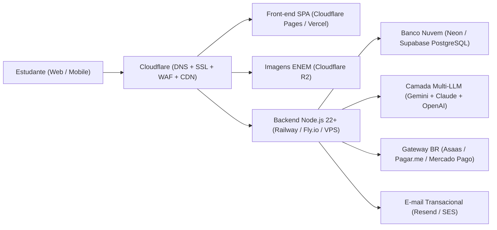

# Arquitetura de Produção, Custos e Estipulação de Mensalidade — NEXO

**Data**: 2026-11-24  
**Base técnica**: Código atual do NEXO (`server/config/plans.ts`, `server/handlers.ts`, `docs/adr/0001–0004`)  
**Premissa de câmbio**: US\$ 1,00 = **R\$ 5,80** (margem conservadora contra alta do dólar)

---

## 1. Arquitetura de Produção Recomendada

### Componentes e Serviços Obrigatórios

| Camada | Serviço Recomendado | Papel no NEXO | Alternativas |
|--------|---------------------|---------------|--------------|
| **Domínio + DNS/SSL** | Registro.br + Cloudflare Free | Domínio `.com.br`, HTTPS automático, proteção DDoS e cache | Route 53 |
| **Front-end (SPA)** | Cloudflare Pages ou Vercel | Servir o build estático `dist/` (React + Vite) com CDN global | Netlify |
| **Backend (API Node 22+)** | Railway, Fly.io ou VPS (Hetzner/DO) | Executar `server/index.ts` 24/7 (auth, billing, ENEM, IA, LGPD) | Render, AWS ECS |
| **Banco de Dados Nuvem** | Neon Postgres ou Supabase Postgres | Contas, assinaturas, ledger de cotas, histórico e acervo ENEM 2009+ | RDS, SQLite em volume (apenas beta de 1 instância) |
| **Storage de Imagens** | Cloudflare R2 | Armazenar figuras espelhadas do ENEM (`AssetStorage`) com **tráfego gratuito (egress zero)** | Amazon S3 + CloudFront |
| **IA (Multi-LLM)** | Gemini 2.5 Flash + Claude Sonnet 4.5 (+ GPT-4o-mini fallback) | Redação C1–C5, Professor de IA, Explicação ativa, Diagnóstico e Questões | Anthropic-only / OpenAI-only |
| **Pagamentos (BR)** | Asaas ou Pagar.me | Assinatura recorrente (Cartão + Pix), pacotes avulsos, webhooks e estorno CDC 7 dias | Mercado Pago, Stripe |
| **E-mail Transacional** | Resend | Recuperação de senha, boas-vindas, recibos e confirmações LGPD | Postmark, Amazon SES |
| **Monitoramento** | Sentry + BetterStack/UptimeRobot | Alertas de erro 500, indisponibilidade e latência | Datadog, Grafana Cloud |

---

## 2. Custos Fixos Mensais de Infraestrutura (por Fase)

| Item | Fase 1: Lançamento (0–300 alunos) | Fase 2: Tração (300–2.000 alunos) | Fase 3: Escala (5.000+ alunos) |
|------|-----------------------------------|-----------------------------------|--------------------------------|
| Domínio `.com.br` (R\$ 40/ano rateado) | R\$ 3,50 | R\$ 3,50 | R\$ 3,50 |
| Cloudflare (DNS + SSL + Pages + R2 até 10 GB) | R\$ 0,00 | R\$ 0,00 – R\$ 30,00 | R\$ 60,00 – R\$ 150,00 |
| Backend Node.js 22+ | R\$ 45,00 (US\$ 8) | R\$ 145,00 (US\$ 25) | R\$ 465,00 (US\$ 80) |
| Banco PostgreSQL Nuvem | R\$ 0,00 – R\$ 50,00 | R\$ 145,00 (US\$ 25) | R\$ 465,00 (US\$ 80) |
| E-mail Transacional (Resend) | R\$ 0,00 (até 3k/mês) | R\$ 116,00 (US\$ 20) | R\$ 116,00 – R\$ 290,00 |
| Monitoramento (Sentry / Uptime) | R\$ 0,00 | R\$ 0,00 – R\$ 150,00 | R\$ 290,00 |
| **Total Fixo Estimado / Mês** | **R\$ 50 – R\$ 100** | **R\$ 410 – R\$ 600** | **R\$ 1.400 – R\$ 1.850** |

> **Observação sobre o Acervo ENEM**: como todas as questões e imagens ficam no Postgres + Cloudflare R2 (egress gratuito), o custo de servir questões e simulados é praticamente **zero por aluno**. O único custo variável técnico relevante é **IA (tokens)**.

---

## 3. Estipulação de Custo de IA (Tokens) por Aluno/Mês

Com base nas cotas já definidas em `server/config/plans.ts` (`DEFAULT_MONTHLY_QUOTAS`):
- **8 correções de redação/mês** (~1.500 tokens entrada / ~1.200 saída cada)
- **300 interações de Professor IA / Explicação / Diagnóstico/mês** (~1.200 entrada / ~400 saída cada)
- **20 gerações de questões inéditas/mês** (~1.000 entrada / ~800 saída cada)

### Volume de Tokens por Aluno/Mês

| Perfil de Uso | Redações | Tutor/Explicação | Questões IA | Tokens Entrada | Tokens Saída |
|---------------|----------|------------------|-------------|----------------|--------------|
| **Uso Médio Realista (35% da cota)** | 3 | 105 | 7 | ~137.000 | ~51.000 |
| **Uso Intenso / Teto (100% da cota)** | 8 | 300 | 20 | **392.000** | **145.600** |

### Comparativo de Custo Mensal de IA por Aluno (Câmbio R\$ 5,80)

| Estratégia de Modelos | Preço Ref. (US\$/1M tokens in / out) | Custo Uso Médio (35%) | Custo Teto (100% cota) | Veredito |
|-----------------------|--------------------------------------|-----------------------|------------------------|----------|
| **A. Econômica** — Gemini 2.5 Flash em tudo | \$0,30 / \$2,50 | **R\$ 0,98** | **R\$ 2,80** | Excelente margem; ótima velocidade |
| **B. Híbrida (Recomendada)** — Claude Sonnet na Redação C1–C5 + Gemini 2.5 Flash no Tutor/Questões | Redação \$3/\$15 · Resto \$0,30/\$2,50 | **R\$ 1,29** | **R\$ 3,68** | **Melhor equilíbrio qualidade pedagógica × margem** |
| **C. Premium Puro** — Claude Sonnet em tudo | \$3,00 / \$15,00 | **R\$ 6,83** | **R\$ 19,52** | Arriscado no plano anual para *heavy users* |
| **D. Opus em tudo** *(não recomendado)* | \$5,00+ / \$25,00+ | **R\$ 11,40+** | **R\$ 32,50+** | **Inviável** (dá prejuízo no plano anual) |

> **Conclusão técnica crítica**: implementar **roteamento por tarefa** (modelo mais robusto na Redação C1–C5 + modelo rápido/econômico no Tutor e Explicação) reduz o custo de IA no teto em **mais de 80%** sem perda perceptível de qualidade, além de permitir fallback automático entre provedores (ADR-0003).

---

## 4. Custos Variáveis Comerciais (Brasil)

Sobre cada assinatura vendida, incidem custos proporcionais à receita:

| Componente | Estimativa Conservadora | Observação |
|------------|-------------------------|------------|
| **Impostos (Simples Nacional)** | **8,0%** | Referência inicial Anexo III (faixa 6%–11,2% conforme faturamento e Fator R) |
| **Gateway de Pagamento (Asaas/Pagar.me)** | **4,0%** | Média ponderada entre Pix (~R\$ 1,50–1,99 fixo) e Cartão à vista/recorrente (~3,5%–4,5%) |
| **Reserva CDC (7 dias) + Chargeback** | **3,0%** | Provisão para direito de arrependimento (CDC) e contestações |
| **Total Deduções Comerciais** | **15,0%** | *(Atenção: no plano Anual parcelado em 12x, repasse os juros da operadora ao pagador ou considere ~10%–14% extras se o NEXO absorver a taxa de antecipação)* |

---

## 5. Análise de Mensalidade e Margem de Contribuição

Usando a **Estratégia B (Híbrida: Sonnet na Redação + Gemini Flash no Tutor/Questões)** e **15% de deduções comerciais**:

### Comparativo de Faixas de Preço (Plano Mensal)

| Mensalidade | Deduções (15%) | IA (Uso Médio / Teto) | **Margem Líquida / Aluno (Médio)** | **Margem Líquida / Aluno (Teto 100%)** | Break-even Infra Fase 1 (R\$ 100) | Break-even Infra Fase 2 (R\$ 500) |
|-------------|----------------|-----------------------|------------------------------------|----------------------------------------|-----------------------------------|-----------------------------------|
| **R\$ 29,90** | -R\$ 4,49 | -R\$ 1,29 / -R\$ 3,68 | **R\$ 24,12 (80,7%)** | R\$ 21,73 (72,7%) | 5 alunos | 21 alunos |
| **R\$ 39,90** | -R\$ 5,99 | -R\$ 1,29 / -R\$ 3,68 | **R\$ 32,62 (81,8%)** | R\$ 30,23 (75,8%) | 4 alunos | 16 alunos |
| **R\$ 49,90** *(atual em `plans.ts`)* | -R\$ 7,49 | -R\$ 1,29 / -R\$ 3,68 | **R\$ 41,12 (82,4%)** | **R\$ 38,73 (77,6%)** | **3 alunos** | **13 alunos** |
| **R\$ 59,90** | -R\$ 8,99 | -R\$ 1,29 / -R\$ 3,68 | **R\$ 49,62 (82,8%)** | R\$ 47,23 (78,8%) | 3 alunos | 11 alunos |

### Análise do Plano Anual (`R$ 399,00/ano` = `R$ 33,25/mês` atual em `plans.ts`)

| Cenário do Anual | Receita/mês equiv. | Deduções | IA (Médio / Teto) | **Margem Líquida / Mês** |
|------------------|--------------------|----------|-------------------|--------------------------|
| **Pix à vista ou Cartão c/ juros do aluno** | R\$ 33,25 | -R\$ 4,99 (15%) | -R\$ 1,29 / -R\$ 3,68 | **R\$ 26,97 (81%)** · Teto: R\$ 24,58 (74%) |
| **Cartão 12x s/ juros (NEXO absorve ~12% extra)** | R\$ 33,25 | -R\$ 8,98 (27%) | -R\$ 1,29 / -R\$ 3,68 | **R\$ 22,98 (69%)** · Teto: R\$ 20,59 (62%) |

### Projeção de Lucro Operacional (Mensal R\$ 49,90 · Mix 60% Mensal / 40% Anual · Estratégia Híbrida)
*(Receita média ponderada ≈ R\$ 43,24/aluno; margem de contribuição média ≈ **R\$ 35,46/aluno/mês** antes de marketing/CAC)*

| Base de Assinantes Ativos | Receita Bruta / Mês | Custos Variáveis (Imposto + Gateway + CDC + IA) | Infra Fixa | **Resultado Operacional (antes de Marketing/CAC)** |
|---------------------------|---------------------|-------------------------------------------------|------------|----------------------------------------------------|
| **50 alunos** | R\$ 2.162 | -R\$ 389 | -R\$ 100 | **+R\$ 1.673 / mês** |
| **200 alunos** | R\$ 8.648 | -R\$ 1.556 | -R\$ 100 | **+R\$ 6.992 / mês** |
| **500 alunos** | R\$ 21.620 | -R\$ 3.890 | -R\$ 500 | **+R\$ 17.230 / mês** |
| **1.500 alunos** | R\$ 64.860 | -R\$ 11.670 | -R\$ 600 | **+R\$ 52.590 / mês** |

---

## 6. Recomendação Final de Precificação

Os valores já configurados em `server/config/plans.ts` estão **muito bem calibrados** para o mercado brasileiro de ENEM (onde plataformas concorrentes cobram entre R\$ 35 e R\$ 75/mês):

1. **Manter o Plano Mensal em R\$ 49,90/mês** (ou oferta de lançamento para fundadores a **R\$ 39,90/mês**).
   - Entrega margem de **~82%** mesmo com 8 redações + 300 interações de IA + banco oficial completo do ENEM.
   - Deixa espaço saudável para investir em aquisição (tráfego pago / influenciadores de vestibulares — CAC alvo de até R\$ 60–90 se paga em 2 meses).
2. **Manter o Plano Anual em R\$ 399,00/ano (12x R\$ 33,25)** — ideal para o ciclo do ENEM (reduz churn nos meses pós-férias e antecipa caixa).
   - **Regra de proteção**: se oferecer 12x sem juros no cartão, configure o gateway para cobrar no mínimo **R\$ 399 no Pix** e **R\$ 429–449 no cartão 12x** (ou repasse os juros da parcela), preservando ~80% de margem.
3. **Manter os Pacotes Avulsos (`ADDONS`)** com margem >85% (ex.: +5 Redações por R\$ 19,90 custam apenas ~R\$ 0,65 de Sonnet), atuando como receita extra exatamente sobre os *heavy users*.
4. **Trava obrigatória antes de vender**:
   - Ativar **Estratégia Híbrida de IA** (nunca deixar `claude-opus` como padrão do tutor).
   - Ativar **Ledger persistido (`QuotasRepository`)** em `server/handlers.ts` para garantir o teto de 8 / 300 / 20 créditos por ciclo.
   - Bloquear `/api/billing/dev/simulate` em produção e integrar gateway real (ex.: **Asaas**).

---

## 7. Checklist de Execução para Ir ao Ar

- [ ] **1. Contas externas**: registrar domínio, criar conta Cloudflare (Pages + R2), Neon/Supabase (Postgres), Railway/Fly (Backend), Gemini + Anthropic (IA), Asaas/Pagar.me (Pagamentos) e Resend (E-mail).
- [ ] **2. Código de produção (5 entregas técnicas)**:
  1. `FallbackChainProvider` + roteamento por tarefa (Sonnet na Redação, Gemini Flash no Tutor) + `QuotasRepository` ligado em `server/handlers.ts`.
  2. Adaptador real de `PaymentGateway` (Asaas/Pagar.me) + validação de webhook + bloqueio do simulador em produção.
  3. Adaptador PostgreSQL nos repositórios (`server/repositories/*`) ou deploy inicial em VPS com volume persistente + backup automático.
  4. `R2AssetStorage` implementando `AssetStorage` (`server/gateways/assets.ts`).
  5. Envio real de e-mail transacional (recuperação de senha) + rate limit HTTP + Sentry.
- [ ] **3. Ingestão do acervo completo**: rodar `npm run ingest:enem` para todos os anos (2009–2023+) com `--inep-dir` (Microdados do INEP para H1–H30 e TRI) apontando para o Postgres + R2 de produção.
